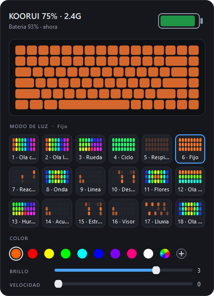
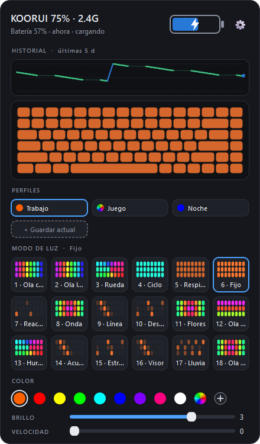
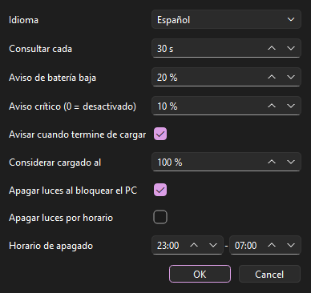

# Koorui Keyboard Software

**English** | [Español](README.md)

Windows tray app that shows the battery level of the **KOORUI 75% wireless keyboard (82 keys, with knob)** in 2.4 GHz mode and lets you change its lighting from the PC.

The panel that opens when you click the tray icon (the interface is available in English and Spanish; screenshots show Spanish):



### Battery display

The tray icon shows the percentage and changes color with the state:


| Color | Meaning |
|---|---|
| Green | Above 50% |
| Orange | 21% to 50% |
| Red | 20% or less (a notification is also shown) |
| Blue | Charging |
| Gray | No reading (keyboard off or receiver unplugged) |

With the cable plugged in, the battery in the panel turns blue with a bolt and the text says "charging":



KOORUI does not publish software for this keyboard and, in 2.4 GHz mode, there is no way to know how much battery is left. This app solves that by talking directly to the USB receiver using a reverse-engineered protocol.

## Features

- **Battery in the tray**: the percentage as a number on the icon, colored by level.
- **Charging detection**: blue icon and a bolt on the battery while the cable is plugged in.
- **History and estimate**: chart of the last days (green while discharging, blue while charging) and approximate time left at the current rate.
- **Notifications**: low battery, critical battery and fully charged, with configurable thresholds.
- **Lighting**: all 18 modes with an animated thumbnail, color (nine presets, multicolor or any other), brightness and speed.
- **Lighting profiles**: save combinations of mode, color, brightness and speed under a name and apply them with one click, from the panel or from the tray menu.
- **Automatic lights off**: when the PC is locked and/or on a schedule (for example 23:00 to 07:00). On unlock or when the schedule ends, your previous brightness comes back. Saves battery.
- **Settings**: language (English or Spanish), polling interval, notification thresholds and automatic lights off.
- Picks up changes made with the keyboard's Fn keys and can start with Windows.

Settings window (gear button or right-click on the tray icon):



## Installation

Neither of the first two options needs Python. The files are in the [latest release](https://github.com/Trukitro/Koorui_Keyboard_Software/releases/latest).

### Option 1: installer (recommended, since v1.3.0)

1. Download `KooruiKeyboardSetup.exe` and run it.
2. Follow the wizard. You can tick "Start with Windows".

It installs for your user only (no administrator rights needed), adds a Start menu shortcut and can be removed from Windows "Installed apps".

### Option 2: portable executable

1. Download `KooruiKeyboard.exe`.
2. Save it in a permanent folder (for example `Documents\Koorui`) and double-click it.

In both cases Windows may show a SmartScreen warning because the files are not signed: click "More info" and then "Run anyway".

### Option 3: from source

Requires Python 3.10 or later.

```bash
git clone https://github.com/Trukitro/Koorui_Keyboard_Software.git
cd Koorui_Keyboard_Software
pip install -r requirements.txt
pythonw koorui_battery.pyw
```

In all cases you need Windows 10 or 11 and the keyboard connected through its 2.4 GHz receiver, which must identify itself as `VID 320F / PID 50C3` ("2.4G Receiver", Telink/EVision).

## Usage

- **Left-click** the icon: open or close the panel.
- **Right-click** the icon: profiles, refresh now, settings, start with Windows, quit.
- **Click** a mode: activates it on the keyboard.
- **Right-click** a mode: change its name and the animation used to represent it.
- **"+ Save current"**: saves the current lighting as a profile.
- **Click** a profile: applies it. **Right-click**: rename, update with the current lights, or delete.
- **Gear**: opens the settings.

Profiles, mode names, battery history (30 days), settings and the error log are stored in `%APPDATA%\KooruiBattery`.

## Building

```bash
pip install pyinstaller
pyinstaller --onefile --noconsole --name KooruiKeyboard --icon assets/icon.ico koorui_battery.pyw
```

The result is `dist\KooruiKeyboard.exe`. If you have PySide6 installed alongside PyQt6, add `--exclude-module PySide6`.

Building the installer requires [Inno Setup 6](https://jrsoftware.org/isinfo.php):

```bash
iscc installer\koorui.iss
```

The result is `dist\KooruiKeyboardSetup.exe`.

## How it works

The receiver exposes a vendor-specific HID collection (usage page `0xFF1C`, usage `0x92`, report ID 4). Packets are 64 bytes:

```
[04][sum_lo][sum_hi][cmd][len][addr_lo][addr_hi][status][data...]
```

The checksum is the sum of bytes 3 to 63. In responses, status `0xFF` means "command not supported".

| Command | Purpose |
|---|---|
| `0x01` / `0x02` | Begin / end a transaction |
| `0x1A` | Battery: percentage in byte 8; byte 9 is 1 while charging |
| `0x05` | Read configuration (24 bytes per packet at most) |
| `0x06` | Write configuration |
| `0x1D` | Model identification (`UK6133`) |

The configuration is flash memory organized in 64-byte pages. Writing at address 0 erases the whole page, so the app always reads the page, changes the bytes it needs and rewrites it completely in three chunks. Reads do not cross a page boundary.

Page 0:

| Byte | Content |
|---|---|
| 1 | Lighting mode (1 to 18) |
| 2 | Brightness (0 to 4) |
| 3 | Speed |
| 5 | `0x00` = fixed color, `0xFF` = multicolor |
| 6–8 | Color: red, green, blue |

Fn keys never reach the PC (the keyboard handles them internally), which is why lighting is controlled by writing this page rather than by simulating key presses.

`snapshot.py` is the read-only tool used to discover this map: it saves a snapshot of the configuration and compares two snapshots to show which bytes change when an Fn combination is pressed.

## Known limitations

- Tested on a single keyboard. Other KOORUI models, or keyboards with a different receiver, will probably not work.
- There is no official documentation for the protocol. The battery reading (discharging and charging), the 18 modes, brightness and speed have been validated on the author's keyboard.
- Mode names come from the usual EVision keyboard table; if one does not describe the effect well, change it with a right-click.
- The panel animations are approximations, not an exact copy of the keyboard's effects.
- Time left is an estimate based on the current discharge run; it needs at least half an hour of readings and a 3-point drop, and it varies with usage and brightness.
- The fully-charged notification fires at the configured level (100% by default). If your keyboard stops at 98 or 99%, lower that level in the settings.
- Automatic lights off sets brightness to 0 and stores the previous value to restore it. If you raise the brightness by hand while it is active, the app respects that until the next lock or schedule.
- The app writes to the keyboard's configuration memory. An invalid block makes the keyboard fall back to its factory lighting. Use it at your own risk.
- Works in 2.4 GHz mode only; Bluetooth and wired modes are not covered.

## Project structure

| File | Content |
|---|---|
| `koorui_battery.pyw` | The app: HID protocol, model, panel and tray icon |
| `snapshot.py` | Read-only tool for investigating the configuration |
| `requirements.txt` | Dependencies |
| `assets/icon.ico` | Executable icon |
| `installer/koorui.iss` | Inno Setup script for the installer |

## Roadmap

What is still unconfirmed and the ideas for future versions are in [ROADMAP.md](ROADMAP.md) (Spanish).

## License

[MIT](LICENSE). Unofficial project, not affiliated with KOORUI.
