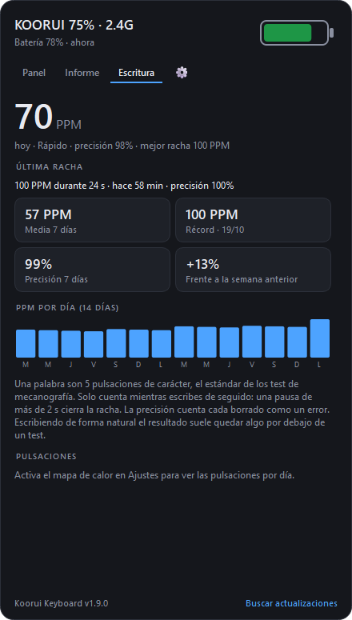
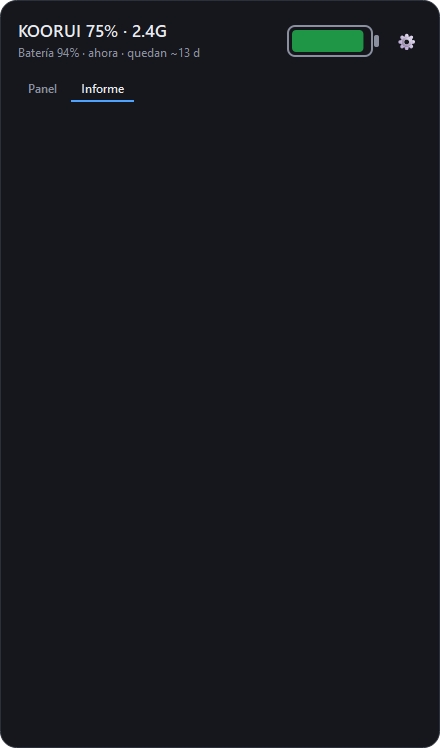
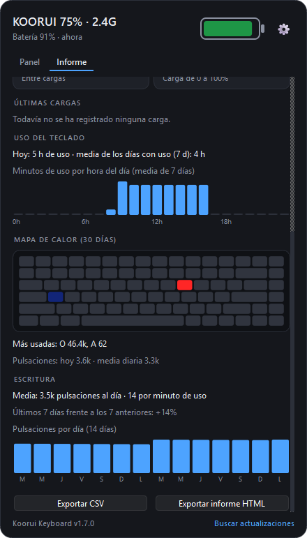

# Koorui Keyboard Software

[English](README.en.md) | **Español**

App de bandeja para Windows que muestra la batería del teclado **KOORUI 75% inalámbrico (82 teclas, con rueda)** y permite cambiar sus luces desde el PC. Pensada para el modo 2.4 GHz; también funciona por cable y, solo para la batería, por Bluetooth.

El panel que se abre al hacer clic en el icono:


### Representación de la batería

El icono en la bandeja del sistema muestra el porcentaje y cambia de color según el estado:


| Color | Significado |
|---|---|
| Verde | Más del 50 % |
| Naranja | Entre 21 % y 50 % |
| Rojo | 20 % o menos (además salta un aviso) |
| Azul | Cargando |
| Gris | Sin lectura (teclado apagado o receptor desconectado) |

Con el cable conectado, la pila del panel pasa a azul con un rayo y el texto indica "cargando":


KOORUI no publica software para este teclado y, en modo 2.4 GHz, no hay forma de saber cuánta batería le queda. Esta app lo resuelve hablando directamente con el receptor USB mediante un protocolo obtenido por ingeniería inversa.

## Qué hace

- **Batería en la bandeja**: el porcentaje como número en el icono, con color según el nivel.
- **Detección de carga**: icono azul y un rayo sobre la pila mientras el cable está conectado.
- **Historial y estimación**: gráfica de los últimos días (verde al descargar, azul al cargar) y tiempo restante aproximado al ritmo actual.
- **Avisos**: batería baja, batería crítica y carga completa, con umbrales configurables.
- **Luces**: los 18 modos con miniatura animada, color (nueve predefinidos, multicolor o cualquier otro), brillo y velocidad.
- **Perfiles de luces**: guarda combinaciones de modo, color, brillo y velocidad con nombre y aplícalas con un clic, desde el panel o desde el menú del icono.
- **Apagado automático de luces**: al bloquear el PC y/o en un horario (por ejemplo de 23:00 a 07:00). Al desbloquear o terminar el horario vuelve el brillo que tenías. Ahorra batería.
- **Informe**: previsión de cuándo cargar, autonomía según el brillo, desgaste de la batería mes a mes, estadísticas de carga, uso del teclado por horas y mapa de calor de teclas (opcional). Se puede exportar a CSV o a un informe HTML.
- **Escritura (palabras por minuto)**: pestaña con tus PPM de hoy, nivel, precisión, mejor racha, media y tendencia semanal, récord y una gráfica día a día. Opcional, desactivada por defecto.
- **Consulta inteligente**: mientras escribes consulta cada 30 s; en reposo baja a cada 5 min y vuelve a leer en cuanto pulsas una tecla.
- **Versión y actualizaciones**: el pie del panel muestra la versión instalada y un botón para buscar actualizaciones. Si hay una nueva, "Actualizar a vX.Y.Z" descarga el instalador, comprueba su huella SHA-256 y lo instala en silencio; la app se vuelve a abrir sola. Una vez al día lo comprueba por su cuenta y avisa en la bandeja. La instalación automática, sin preguntar, es opcional en los ajustes.
- **Avisos de uso**: aviso de previsión cuando vas a llegar al umbral de batería baja en menos de un día ("llegarás al 20 % mañana hacia las 10:00"), y recordatorio de pausa tras un tiempo escribiendo sin parar (60 min por defecto).
- **Copia de seguridad**: exportar e importar en un archivo los perfiles, nombres de modos, ajustes, historial, uso y pulsaciones, desde los ajustes.
- **Ajustes**: idioma (español o inglés), intervalo de consulta, umbrales de aviso y apagado automático.
- Detecta los cambios hechos con las teclas Fn del teclado y puede iniciarse con Windows.

Pestaña de ajustes (el engranaje junto a Panel e Informe, o "Ajustes" en el clic derecho del icono). Los cambios se guardan al momento:


Pestaña de escritura, con las palabras por minuto día a día:



Cómo se miden las PPM: una palabra son 5 pulsaciones de carácter (letras, números, signos y espacio), el estándar de los test de mecanografía. Solo cuentan las rachas en que escribes de seguido: una pausa de más de 2 s cierra la racha, y las de menos de 20 caracteres o 6 segundos se descartan. La precisión cuenta cada borrado como un error. Al medir mientras escribes de forma natural, el resultado suele quedar algo por debajo de un test.

Pestaña de informe:





Qué muestra el informe:

- **Previsión**: cuánto te queda al ritmo actual y qué día conviene cargarlo (al llegar al umbral de batería baja).
- **Autonomía según el brillo**: cuántas horas de uso da una carga completa con cada nivel de brillo, y cuántos puntos de batería gasta por hora. Solo cuenta el tiempo en que el teclado está despierto.
- **Desgaste de la batería**: autonomía de cada mes con el brillo que más usas; si baja con el tiempo, la batería se está desgastando. Necesita al menos dos meses de datos.
- **Cargas**: cuándo fue la última, cargas por semana, tiempo medio entre cargas y cuánto tarda una carga de 0 a 100 %, más las cinco últimas cargas.
- **Uso del teclado**: minutos de uso de hoy, media de los días que lo usas y una gráfica de uso por hora del día.
- **Mapa de calor** (opcional, desactivado por defecto): el teclado coloreado según cuántas veces pulsas cada tecla en los últimos 30 días, y las teclas más usadas.
- **Exportar**: el historial de lecturas en CSV (se abre en Excel) o un informe HTML con todo lo anterior.

### Privacidad

Para saber cuándo usas el teclado, la app recibe de Windows los avisos de pulsación (Raw Input) y se queda solo con los de este teclado:

- Sin el mapa de calor, de cada pulsación solo usa el minuto en que ocurrió, para sumar minutos de uso.
- Con el mapa de calor activo, suma además uno al contador de esa tecla por día. Nunca guarda qué escribes ni en qué orden.
- Al desactivar el mapa de calor se borran los contadores.
- Con la medición de PPM activa, de cada pulsación solo usa si es un carácter, un borrado u otra tecla, y el tiempo entre pulsaciones; guarda por día los caracteres, segundos y borrados de las rachas, nunca qué escribes.
- Todo se guarda solo en tu PC. Las únicas conexiones a internet son con GitHub: la consulta diaria de versiones (desactivable en los ajustes) y la descarga del instalador cuando actualizas.

## Instalación

Ninguna de las dos primeras opciones necesita Python. Los archivos están en la [última versión publicada](https://github.com/Trukitro/Koorui_Keyboard_Software/releases/latest).

### Opción 1: instalador (recomendada, desde la v1.3.0)

1. Descarga `KooruiKeyboardSetup.exe` y ábrelo.
2. Sigue el asistente. Puedes marcar "Iniciar con Windows".

Se instala solo para tu usuario (no pide permisos de administrador), crea un acceso en el menú Inicio y se desinstala desde "Aplicaciones instaladas" de Windows.

### Opción 2: ejecutable portable

1. Descarga `KooruiKeyboard.exe`.
2. Guárdalo en una carpeta fija (por ejemplo `Documentos\Koorui`) y ábrelo con doble clic.

En ambos casos Windows puede mostrar el aviso de SmartScreen porque los archivos no están firmados: pulsa "Más información" y luego "Ejecutar de todas formas".

### Opción 3: desde el código

Requiere Python 3.10 o posterior.

```bash
git clone https://github.com/Trukitro/Koorui_Keyboard_Software.git
cd Koorui_Keyboard_Software
pip install -r requirements.txt
pythonw koorui_battery.pyw
```

En todos los casos hace falta Windows 10 u 11 y el teclado conectado en alguno de los modos de la tabla siguiente.

## Uso

- **Clic izquierdo** en el icono: abre o cierra el panel.
- **Clic derecho** en el icono: perfiles, actualizar ahora, ajustes, iniciar con Windows, salir.
- **Clic** en un modo: lo activa en el teclado.
- **Clic derecho** en un modo: cambia su nombre y la animación con la que se representa.
- **"+ Guardar actual"**: guarda las luces de ese momento como perfil.
- **Clic** en un perfil: lo aplica. **Clic derecho**: renombrar, actualizar con las luces actuales o eliminar.
- **Pestaña del engranaje**: ajustes; cada cambio se guarda al momento.

Los perfiles, los nombres de los modos, el historial de batería (90 días), los ajustes y el registro de errores se guardan en `%APPDATA%\KooruiBattery`.

## Publicar una versión

Al publicar una versión en GitHub, la acción [`Compilar`](.github/workflows/release.yml) genera en Windows el ejecutable y el instalador y los adjunta a esa versión. También publica `SHA256SUMS.txt` con la huella de cada archivo; la app no instala una actualización si la huella no coincide. Antes de publicar, sube `APP_VERSION` en `koorui_battery.pyw` al mismo número que la etiqueta:

```bash
gh release create v1.6.0 --title "v1.6.0" --notes "Novedades..."
```

También se puede lanzar a mano desde la pestaña Actions; entonces deja los archivos como artefacto para descargar.

## Compilar el ejecutable

```bash
pip install pyinstaller
pyinstaller --onefile --noconsole --name KooruiKeyboard --icon assets/icon.ico koorui_battery.pyw
```

El resultado queda en `dist\KooruiKeyboard.exe`. Si tienes PySide6 instalado además de PyQt6, añade `--exclude-module PySide6`.

Para generar el instalador hace falta [Inno Setup 6](https://jrsoftware.org/isinfo.php):

```bash
iscc installer\koorui.iss
```

El resultado queda en `dist\KooruiKeyboardSetup.exe`.

## Modos de conexión

El modo principal es 2.4 GHz. Cable y Bluetooth funcionan como opciones; la app detecta sola en qué modo está el teclado y lo muestra junto al nombre.

| Modo | Se identifica como | Batería | Carga | Luces y perfiles |
|---|---|---|---|---|
| **2.4 GHz** (principal) | `320F:50C3` "2.4G Receiver" | Sí | Sí | Sí |
| Cable USB | `320F:50C2` "USB Gaming Keyboard" | Sí | Sí | Sí |
| Bluetooth | `245A:8276` "MK082-5.0" | Sí | No | No |

Por cable el teclado usa el mismo protocolo que el receptor. Por Bluetooth no existe ese canal: la batería la publica el servicio estándar de batería de Bluetooth LE y la app la lee de Windows, así que en ese modo no se pueden cambiar las luces ni saber si está cargando.

## Cómo funciona

El receptor expone una colección HID propietaria (usage page `0xFF1C`, usage `0x92`, report ID 4). Los paquetes tienen 64 bytes:

```
[04][suma_lo][suma_hi][cmd][len][dir_lo][dir_hi][estado][datos...]
```

La suma es la de los bytes 3 a 63. En las respuestas, un estado `0xFF` significa "comando no soportado".

| Comando | Función |
|---|---|
| `0x01` / `0x02` | Abrir / cerrar una transacción |
| `0x1A` | Batería: porcentaje en el byte 8; el byte 9 vale 1 mientras carga |
| `0x05` | Leer configuración (máximo 24 bytes por paquete) |
| `0x06` | Escribir configuración |
| `0x1D` | Identificación del modelo (`UK6133`) |

La configuración es memoria flash organizada en páginas de 64 bytes. Escribir en la dirección 0 borra la página entera, así que la app siempre lee la página, cambia los bytes necesarios y la reescribe completa en tres trozos. Las lecturas no cruzan el límite de una página.

Página 0:

| Byte | Contenido |
|---|---|
| 1 | Modo de luz (1 a 18) |
| 2 | Brillo (0 a 4) |
| 3 | Velocidad |
| 5 | `0x00` = color fijo, `0xFF` = multicolor |
| 6–8 | Color: rojo, verde, azul |

Las teclas Fn nunca llegan al PC (las interpreta el propio teclado), por eso las luces se controlan escribiendo esta página y no simulando pulsaciones.

`snapshot.py` es la herramienta de solo lectura usada para descubrir el mapa: guarda una foto de la configuración y compara dos fotos para ver qué bytes cambian al pulsar una combinación Fn.

## Limitaciones conocidas

- Probado en un solo teclado. Otros modelos de KOORUI, u otros teclados con un receptor distinto, probablemente no funcionen.
- No hay documentación oficial del protocolo. La lectura de batería (descarga y carga), los 18 modos, el brillo y la velocidad están validados en el teclado del autor.
- Los nombres de los modos vienen de la tabla habitual de los teclados EVision; si alguno no describe bien el efecto, se cambia con clic derecho.
- Las animaciones del panel son aproximaciones, no una copia exacta de los efectos del teclado.
- El uso por horas y el mapa de calor empiezan a contar desde la v1.6.0, y solo mientras la app está abierta.
- La actualización desde la app funciona a partir de la v1.7.0 (las versiones anteriores no publican la huella SHA-256) y deja la app instalada con el instalador; si usabas el ejecutable portable, a partir de ahí se usa la versión instalada.
- El informe necesita datos: la autonomía de cada brillo aparece tras 2 h de uso con ese brillo y una caída de 3 puntos, y las estadísticas de carga tras unos días. Las lecturas guardadas antes de la v1.5.0 no incluyen el brillo, así que no cuentan para la autonomía.
- El tiempo restante es una estimación a partir del tramo de descarga actual; necesita al menos media hora de lecturas y una caída de 3 puntos, y cambia según el uso y el brillo.
- El aviso de carga completa salta al llegar al nivel configurado (100 % por defecto, que es donde termina de cargar el teclado del autor).
- El apagado automático pone el brillo a 0 y guarda el valor anterior para restaurarlo. Si subes el brillo a mano mientras está activo, la app lo respeta hasta el siguiente bloqueo u horario.
- La app escribe en la memoria de configuración del teclado. Un bloque inválido hace que el teclado vuelva a su iluminación de fábrica. Úsala bajo tu responsabilidad.
- Por Bluetooth solo hay batería (sin luces ni detección de carga), y el valor es el que Windows tenga guardado, que puede tardar en actualizarse.
- Si el teclado lleva unos minutos sin usarse entra en reposo y deja de contestar; la app conserva la última lectura y la marca con el tiempo transcurrido.

## Estructura del proyecto

| Archivo | Contenido |
|---|---|
| `koorui_battery.pyw` | La app: protocolo HID, modelo, panel e icono de bandeja |
| `snapshot.py` | Herramienta de solo lectura para investigar la configuración |
| `requirements.txt` | Dependencias |
| `assets/icon.ico` | Icono del ejecutable |
| `installer/koorui.iss` | Guion de Inno Setup para el instalador |
| `.github/workflows/release.yml` | Compilación automática al publicar una versión |

## Plan a futuro

Lo que queda por confirmar y las ideas para próximas versiones están en [ROADMAP.md](ROADMAP.md).

## Licencia

[MIT](LICENSE). Proyecto no oficial, sin relación con KOORUI.
